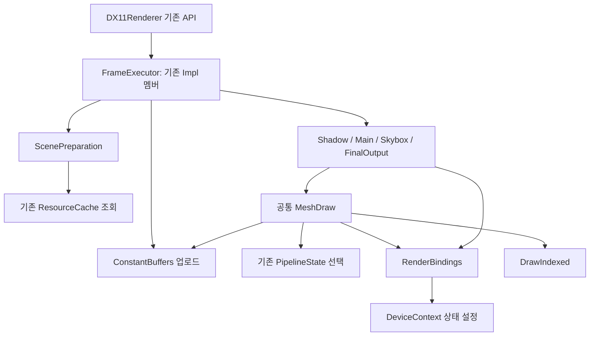

# DX11Renderer 책임 분리 결과

## 범위와 기존 호출 흐름

변경은 `Engine/DX11Renderer/` 내부에 한정했다. 공개 `DX11Renderer.h`, 엔진의
Renderer/Application, Game, Editor, Common 소스와 외부 빌드 설정은 변경하지 않았다.
기존 PipelineState, ShaderCompiler, ResourceCache, GPUProfiler와 셰이더 코드도 유지했다.

기존 `BeginFrame`은 화면 준비와 기본 조명 업로드를 수행했고, `DrawScene`이 카메라,
장면 상수, 그림자와 메인 렌더링을 처리했다. `EndFrame`은 최종 출력, 선택적인 에디터
Overlay와 Present를 수행했다. 이 호출 계약과 출력 순서는 그대로다.

혼합 책임은 다음과 같았다.

- `UploadLights`: 조명 패킹, 그림자 리소스 생성, 그림자 행렬 계산, 세 버퍼 업로드와 그림자 드로우.
- `UpdateObjectConstants`: 행렬 계산, 업로드와 VS b0 바인딩.
- `BindMaterial`: 캐시 조회, 텍스처 선택, 상수 계산, 업로드와 바인딩.
- `BindSharedConstants`: dirty 검사, View/Scene 업로드와 공통 리소스 바인딩.
- Skybox/FinalOutput: 상수 계산 및 업로드와 패스 실행이 한 함수에 집중.

## 파일과 책임

| 모듈 | 파일 | 역할 |
| --- | --- | --- |
| 공개 진입점 | `DX11Renderer.cpp` | 기존 API, 설정 및 리소스 생성/제거 요청 전달 |
| 소유 구조 | `Internal/DX11RendererImpl.h/.cpp` | 기존 비공개 Impl의 상태, COM 소유권, 타겟/버퍼 생성과 크기 변경 |
| 데이터 준비 | `Frame/DX11ScenePreparation.h/.cpp` | 카메라/객체/장면/조명/그림자 계산, 재질 조회, 드로우 분류와 안정적인 투명 정렬 |
| 실행 모듈 | `Frame/DX11FrameExecutor.cpp` | 기존 Impl 멤버로 프레임 시작, 장면 준비/업로드/패스 순서, 직접 드로우와 종료 조율 |
| 업로드 | `Pipeline/DX11ConstantBuffers.h/.cpp` | 버퍼 데이터 갱신과 dirty 상태 처리; 바인딩/드로우 없음 |
| 바인딩 | `Pipeline/DX11RenderBindings.h/.cpp` | 파이프라인, 공통 상수, 타겟, 재질 및 기하 버퍼 연결; 업로드/드로우 없음 |
| 공통 드로우 | `Pipeline/DX11MeshDraw.h/.cpp` | 객체/재질 업로드와 바인딩을 조합하고 기존 통계를 유지하며 DrawIndexed 제출 |
| 패스 | `Pass/DX11ShadowPass.h/.cpp` | 그림자 DSV 전환, 클리어, 캐스터 드로우 및 메인 타겟/뷰포트/기본 파이프라인 복원 |
| 패스 | `Pass/DX11MainPass.h/.cpp` | Opaque/Masked와 Transparent 드로우 실행 |
| 패스 | `Pass/DX11SkyboxPass.h/.cpp` | 준비된 스카이박스 렌더링과 t2/s2/b6 정리 |
| 패스 | `Pass/DX11FinalOutputPass.h/.cpp` | 최종 컬러 또는 깊이 표시, t0/b0 정리 |
| 검증 | `Tests/ShadowValidation.cpp` | 실제 라이브러리를 링크하는 CPU/WARP GPU 통합 검증 |
| 프로젝트 | `DX11Renderer.vcxproj`, `.filters` | 새 내부 모듈 등록 |

모든 모듈을 클래스로 만들지 않았다. 패스, 준비, 업로드, 바인딩과 공통 메시 제출은
네임스페이스 함수다. 기존 비공개 PImpl을 재사용하고, 실행 모듈도 그 멤버 구현을 모은
파일이므로 새로운 실행기 객체, 가상 인터페이스, 범용 패스 시스템은 없다.
별도 `DX11FrameExecutor.h`는 만들지 않았다. 실행 멤버 선언은 내부 Impl 헤더에 이미 있다.

## 소유권과 의존성

- Impl이 Device/Context, ResourceCache, PipelineState, 상수버퍼, 렌더 타겟과 그림자 리소스를 소유한다.
- ResourceCache는 기존 메시/재질/텍스처/큐브맵 소유 범위를 유지한다.
- PipelineState는 셰이더와 고정 상태를 소유하고, 기존 PipelineSelection으로 포인터를 전달한다.
- SceneConstantBuffers, SceneBindings, MainTargets, MeshDrawContext는 필요한 핸들과 참조만 빌린다.
- 각 패스는 공개 렌더러나 Impl에 직접 의존하지 않는다. Window/SwapChain/설정 전체도 전달하지 않는다.
- 준비한 메시와 SRV 참조는 동기적인 DrawScene/DrawMesh 호출 동안만 유효하다. 다음 프레임까지 보관하지 않는다.
- COM 멤버 순서와 Context::ClearState를 통한 종료 처리는 유지했다.



## 실행 순서와 UploadLights 대체

```text
BeginFrame
  기존 리사이즈/계측/클리어
  기본 조명 데이터 준비 및 업로드, 이전 그림자 상태 해제

DrawScene
  ScenePreparation::PrepareScene
  ResolveLighting (필요한 그림자 리소스 확보와 CPU 계산 조율)
  ConstantBuffers::UploadLighting + UploadPending
  ShadowPass
  공통 리소스 바인딩
  MainPass Opaque/Masked
  Skybox 상수 업로드 + SkyboxPass
  MainPass Transparent

EndFrame
  최종 출력 정보 준비와 필요한 깊이 표시 상수 업로드
  FinalOutputPass
  기존 Overlay 콜백 (설정된 경우)
  기존 계측 종료/통계 완료/Present
```

`UploadLights`는 제거했다. CPU 계산은 `PrepareLights`/`PrepareShadow`, GPU 버퍼 갱신은
`UploadLighting`, 실제 그림자 드로우는 `ShadowPass::Execute`로 나뉜다.
리소스 생성은 기존 `EnsureShadowResources`에 남고 실행 모듈은 이를 호출만 한다.
카메라/장면 업로드는 바인딩 함수 밖에서 명시적으로 수행한다.

Object/Material 상수는 각 드로우 직전에 업로드한다. CPU 객체 상수와 재질은 장면 준비
단계에서 계산해 Shadow/Main에서 공유한다. Opaque 그림자에는 PS/재질 바인딩을 추가하지
않았고 Masked 그림자에는 기존 알파 테스트 재질과 텍스처를 바인딩한다.

BeginFrame 뒤에 장면을 수집하는 기존 호출 순서 때문에 모든 업로드를 BeginFrame으로
이동하지 않았다. 직접 SetCamera+DrawMesh 경로에서는 변경된 View/Scene을 먼저 업로드한다.

## 유지와 검증

단계별 Debug 빌드와 기존 CPU/GPU 검증을 통과한 뒤 다음 단계로 진행했다.
최종적으로 다음 항목을 확인했다.

- DX11Renderer Debug/Release/Shipping x64 빌드 통과.
- 기존 메시, 조명, Masked/Transparent, PCF/PCSS, 그림자 리소스 실패/복구와 Skybox 검증 통과.
- 기준 PPM 이미지 9개가 리팩터링 전후 SHA-256 및 바이트 단위로 일치.
- 한 프레임에서 빈 장면 뒤 실제 장면을 그려 상태 초기화와 두 번째 장면의 출력 일치 확인.
- 직접 DrawMesh 전과 같은 프레임의 두 번째 드로우 전에 바뀐 카메라가 GPU 버퍼에 반영됨을 readback으로 확인.
- 드로우/삼각형 통계와 GPU 프레임/장면/최종 출력 계측 정상 동작 확인.
- 독립 장면 크기, DisplayTexture 출력, Overlay 콜백과 창 크기 복귀 확인.
- D3D11 Debug Layer 경고/오류 0건. DSV/SRV 충돌과 패스 이후 상태 복원 검사 포함.
- 엔진/Game/Editor/Common 소스 해시 불변, 공개 헤더 불변 및 CRLF 유지 확인.

검증은 WARP 통합 테스트와 렌더러 라이브러리 빌드 기준이다. 실제 하드웨어 GPU의 수동
플레이, 에디터 UI 전체 조작과 창 포커스를 요구하는 단축키는 직접 검증하지 않았다.
디버그 설정 API/뷰/프로파일러 구현은 리팩터링 대상에서 제외했으며 기존 동작을 연결했다.
MSVC의 alignas 포함 CPU 구조체 패딩 경고(C4324)와 검증용 /Z7 옵션 재정의 경고는 남아 있다.

## 남은 개선 후보

- 타겟 생성/리사이즈와 일반 상수버퍼 생성은 기존 Impl이 계속 담당한다.
- 디버그 설정/매크로/계측의 별도 격리는 이번 범위에서 의도적으로 제외했다.
- 조명 수 제한, 첫 방향광의 단일 그림자, Spot 미지원 등 기존 알고리즘 제한은 유지했다.
- 성능이 필요한 경우 준비 목록 메모리 재사용이나 재질 업로드 캐시를 별도 측정 후 검토할 수 있다.
- 테스트의 private 접근은 남아 있지만 구현 CPP 포함은 제거했다.
